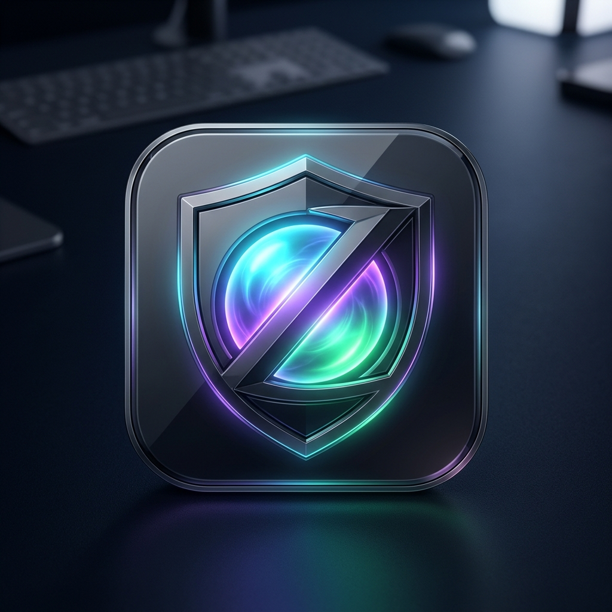
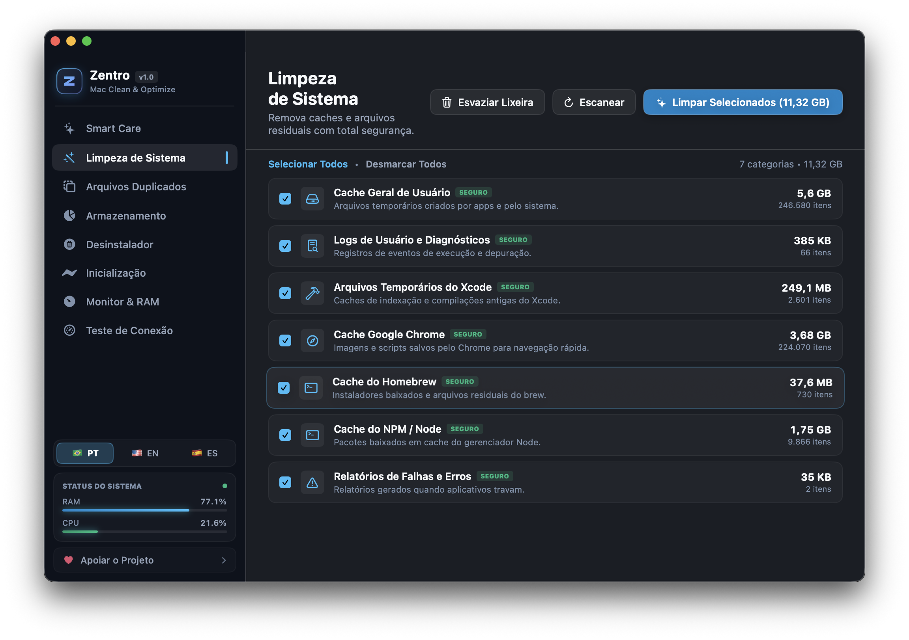
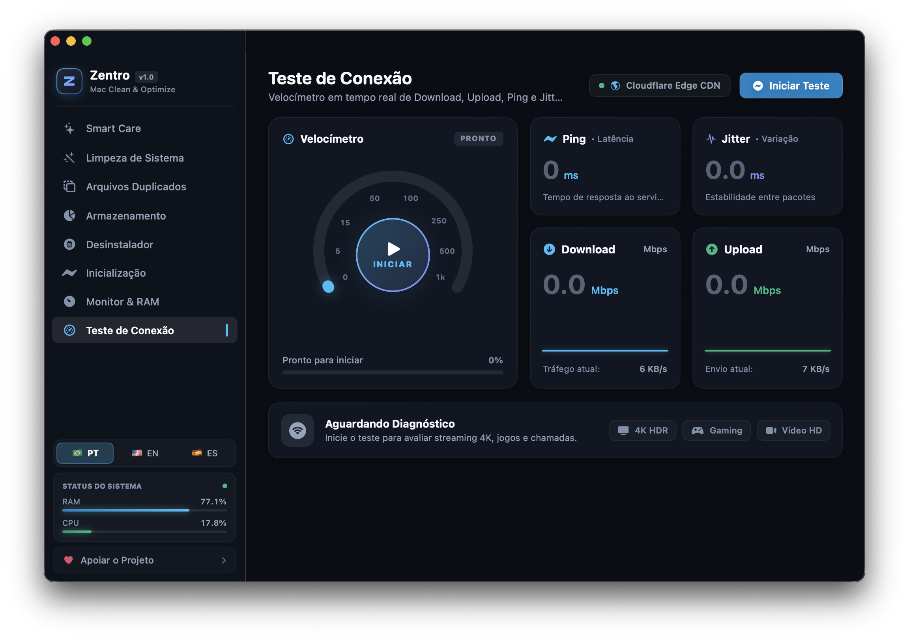
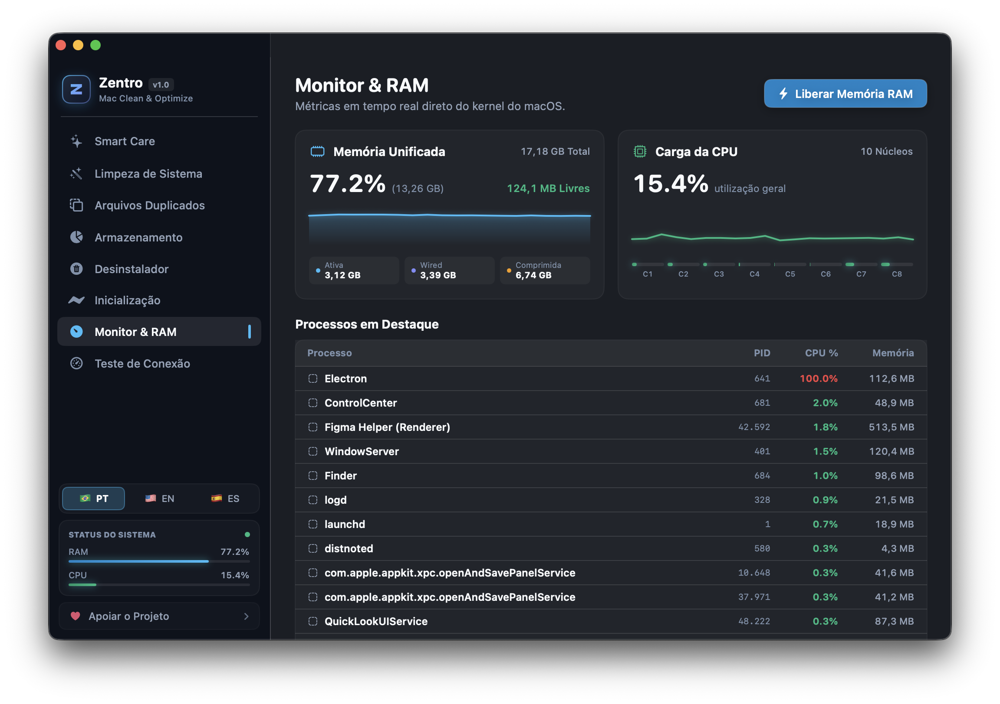
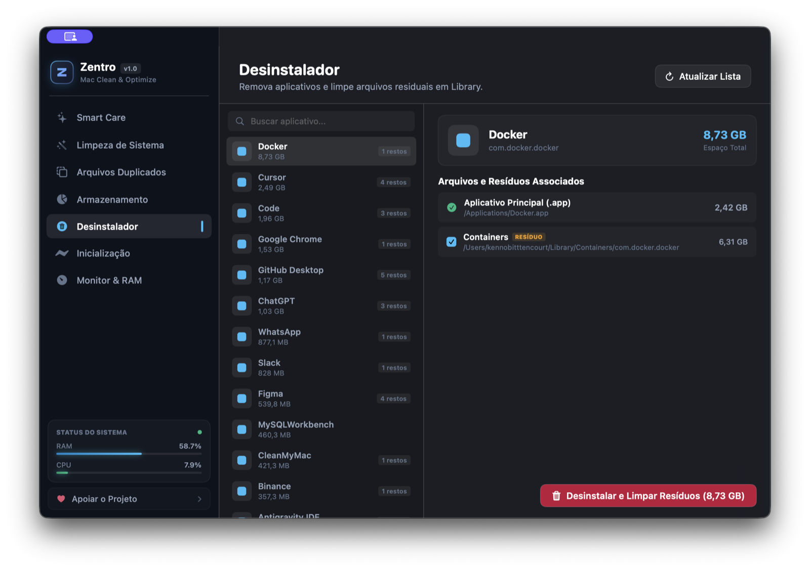
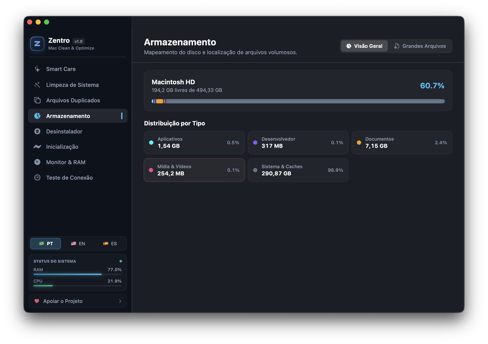
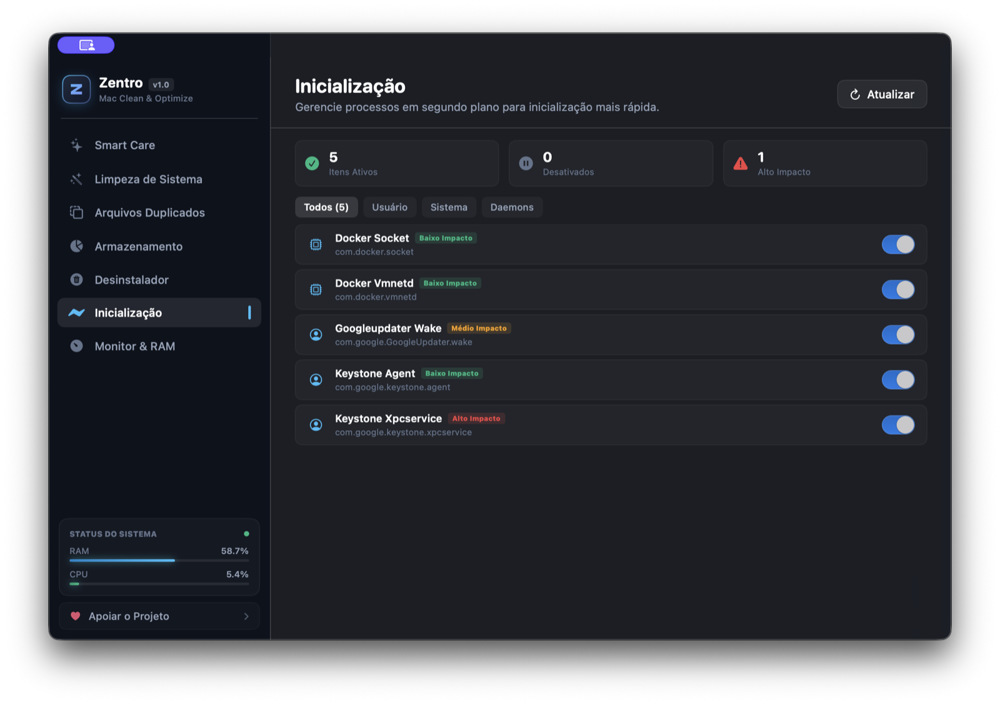

  

<h1 align="center">Zentro</h1>

  <b>Otimizador, Limpador e Monitor Nativo para macOS</b> 
  Desenvolvido por <b>Kenno Bittencourt</b> em Swift 6 &amp; SwiftUI puro com estética <b>Dark Glassmorphism</b>, agente inteligente na barra de menus, velocímetro de conexão e telemetria de hardware em tempo real.

  
  

  
  
  
  
  

---

## 📸 Capturas de Tela do Aplicativo

  

  
  

  
  

  
  

---

## ✨ Recursos Principais

- 🌟 **Smart Care**: Orbe giroscópico interativo com diagnóstico completo em segundos e relatório unificado de saúde, limpeza e performance do Mac.
- 🖥️ **Agente na Barra de Menus (Menu Bar)**: Continua ativo em segundo plano na barra superior do macOS mostrando a saúde do Mac, espaço em disco, pressão de memória (com otimização em 1 clique), bateria, carga da CPU, tráfego Wi-Fi ao vivo, Speedtest compacto e drives externos conectados.
- 🌐 **Teste de Conexão (Speedtest)**: Velocímetro em tempo real de **Download**, **Upload**, **Ping (Latência)** e **Jitter**, com gráficos sparkline ao vivo e diagnóstico automático para **Streaming 4K HDR**, **Cloud Gaming** e **Videochamadas HD**.
- 🧹 **Limpeza de Sistema**: Remoção segura de caches de usuário, logs de diagnóstico, lixeira, arquivos temporários do Xcode (`DerivedData`), caches de navegadores e gerenciadores de pacotes (`Homebrew`, `NPM`).
- 👯 **Arquivos Duplicados**: Motor ultrarrápido de comparação por hash criptográfico **SHA-256** para localizar fotos, vídeos, instaladores e documentos repetidos.
- 📊 **Gerenciamento de Armazenamento**: Mapeamento visual por categorias do disco e filtro inteligente para localizar **Grandes Arquivos (>100 MB)** esquecidos.
- 🗑️ **Desinstalador Completo**: Remoção completa de aplicativos junto com todos os arquivos residuais ocultos em `~/Library/Application Support`, `Caches`, `Preferences` e `Containers`.
- 🚀 **Inicialização do Mac**: Gerenciamento de agentes em segundo plano (`LaunchAgents` e `LaunchDaemons`) com classificação de impacto para acelerar a inicialização do macOS.
- ⚡ **Monitor & RAM**: Telemetria contínua direto do kernel Darwin/Mach, gráficos de histórico de Memória Unificada e CPU por núcleo, lista de processos em destaque e liberação de páginas inativas de RAM.
- 🌍 **Multilíngue Nativo (`PT-BR` • `EN` • `ES`)**: Seletor integrado com troca instantânea entre **Português do Brasil** (padrão), **Inglês** e **Espanhol**.

---

## 📦 Como Instalar no seu Mac

1. Acesse a página de **[Releases Oficiais](https://github.com/Kennobittencourt/Zentro/releases/latest)** ou a nossa **[Página Oficial](https://kennobittencourt.github.io/Zentro/)**.
2. Baixe o instalador oficial: **`Zentro-macOS-arm64.dmg`**.
3. Abra o arquivo `.dmg` e arraste o ícone do **Zentro** para a pasta **Aplicativos** (`Applications`).
4. Abra o Zentro pelo Spotlight ou Launchpad e execute o seu primeiro **Smart Care**!

---

## 💻 Requisitos do Sistema

- **Sistema Operacional**: macOS 14.0 (Sonoma) ou macOS 15.0+ (Sequoia)
- **Processador**: Apple Silicon (M1, M2, M3, M4 ou superior)
- **Arquitetura**: `arm64` nativo em Swift 6 (consumo inferior a 25 MB de RAM)
- **Idiomas Inclusos**: Português (Brasil), Inglês e Espanhol

---

## 🌐 Links Oficiais

- **Página Oficial (Web)**: **[kennobittencourt.github.io/Zentro](https://kennobittencourt.github.io/Zentro/)**
- **Repositório Público & Releases**: **[github.com/Kennobittencourt/Zentro](https://github.com/Kennobittencourt/Zentro)**
- **Repositório de Desenvolvimento**: **[github.com/Kennobittencourt/zentro-dev](https://github.com/Kennobittencourt/zentro-dev)**

---

## 📄 Licença

Distribuído sob a licença **MIT**. Veja [`LICENSE`](LICENSE) para mais detalhes.  
Copyright © 2026 Kenno Bittencourt. Todos os direitos reservados.
