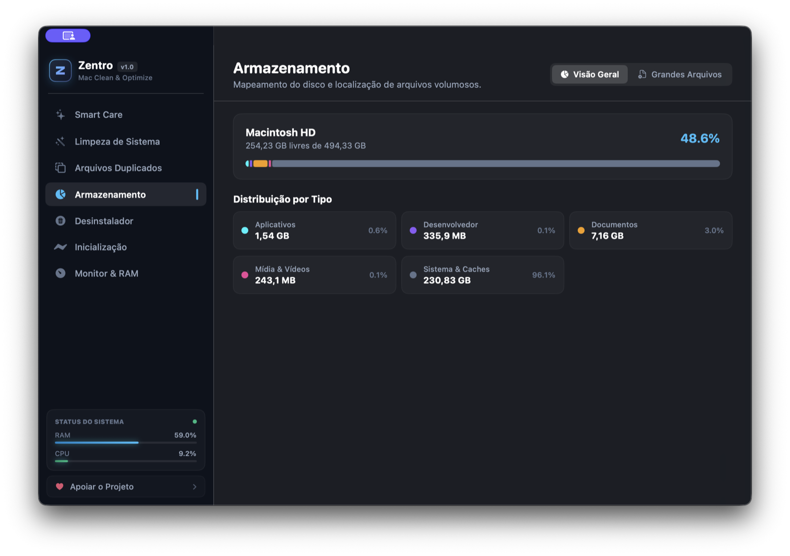

# Zentro

Otimizador e limpador nativo para macOS (Apple Silicon).

🌐 **Site:** https://kennobittencourt.github.io/Zentro/

⬇️ **[Baixar Zentro para macOS (.dmg)](https://github.com/Kennobittencourt/Zentro/releases/latest/download/Zentro-macOS-arm64.dmg)** · [Todas as versões](https://github.com/Kennobittencourt/Zentro/releases)

Requer macOS 14 (Sonoma) ou superior.

Desenvolvido por Kenno Bittencourt.
